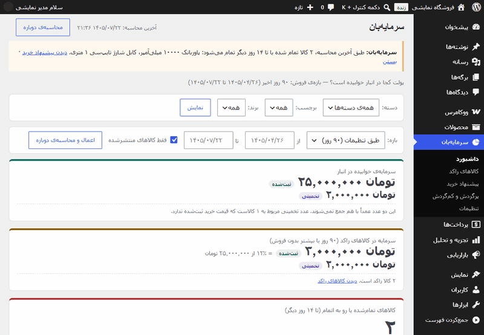

<div dir="rtl">

# سرمایه‌بان (Sarmayeban) — تحلیل سرمایه‌ی انبار برای ووکامرس

**ببینید چقدر پول در انبارتان خوابیده، کدام کالاها دیگر فروش نمی‌روند، و پیش از تمام شدن موجودی چه چیزی بخرید؛ بدون اینکه افزونه حتی یک چیز را در فروشگاهتان تغییر دهد.**

[English](README.md)



**نسخه‌ی ۱٫۰٫۱** · **سازنده: [شاهین پارسا](https://www.linkedin.com/in/shahin-parsa/)** · کد منبع: خصوصی (محصول تجاری). این مخزن ویترین است: معرفی، تصویرها و شواهد کیفیت.

---

## ۱. مسئله

یک فروشگاه اینترنتی کوچک لوازم جانبی موبایل می‌فروشد. صاحبش عددهای فروش را می‌داند، ولی این‌ها را نه:

- **۲۵ میلیون تومان** همین حالا در انبار خوابیده است، و **۳ میلیون تومانش (۱۲٪)** در کالاهایی است که ۹۰ روز یا بیشتر فروش نرفته‌اند.
- پاوربانک همین حالا **تمام شده** و کابل شارژ **۱۲ روز دیگر** تمام می‌شود، در حالی که تأمین‌کننده **۱۴ روز** برای رساندن کالا وقت لازم دارد.
- یک قاب گوشی در **۲۰۰ روز** از روزی که به سایت اضافه شده **هرگز فروش نرفته**، ولی کسی متوجه نشده، چون قیمت خریدی برایش ثبت نشده است.

پیدا کردن این‌ها با دست یعنی خروجی گرفتن از سفارش‌ها، تطبیق با کالاها، حساب فروش روزانه و پوشش موجودی، و تکرار همه‌ی این‌ها هر هفته. (عددها از فروشگاه نمایشی خیالیِ همین تصویرها است.)

## ۲. چه می‌کند

| صفحه | صاحب فروشگاه چه می‌بیند |
|---|---|
| **داشبورد** | پول خوابیده در انبار (قیمت خرید ثبت‌شده و تخمینی جدا، و هرگز جمع‌نشده)، سهم کالاهای راکد، کالاهای رو به اتمام، ارزش به قیمت خرید امروز، و فهرست کوتاهی از کارهایی که امروز ارزش انجام دارند |
| **کالاهای راکد** | کالاها گروه‌بندی‌شده بر اساس روزهای بدون فروش (۳۰، ۶۰، ۹۰، ۱۸۰ به بالا)، پول هر گروه، کالاهایی که هرگز فروش نرفته‌اند، و کالاهای ناموجود و بدون فروش |
| **پیشنهاد خرید** | برای هر کالا: موجودی، فروش روزانه، روزهای باقی‌مانده، نقطه‌ی سفارش و مقدار پیشنهادی، با وضعیت بحرانی / کم / عادی، همراه با فایل CSV فهرست خرید |
| **پرگردش و کم‌گردش (ABC)** | کالاها به ترتیب درآمد خالص در گروه‌های A (حدود ۸۰٪ درآمد)، B (۱۵٪ بعدی) و C، با سهم هر گروه از پول خوابیده |
| **تنظیمات** | بازه‌ی فروش، وضعیت‌های سفارشِ حساب‌شده، مرز «راکد»، زمان تأمین، روزهای اطمینان و پوشش هدف (در صورت نیاز برای هر دسته)، حاشیه‌ی سود فرضی |
| **هشدار پیشخوان** | هشداری در پیشخوان وردپرس وقتی کالایی تمام شده یا رو به اتمام است |

فیلتر دسته، برچسب، برند و بازه‌ی فروش، از جمله بازه‌ی دلخواه با تاریخ شمسی، در همه‌ی صفحه‌های نتیجه کار می‌کند.

<p>


</p>
<p>


</p>
<p>


</p>

## ۳. چه فرقی دارد

| | جدول اکسل دستی | افزونه‌ی معمولی مدیریت انبار | سرمایه‌بان |
|---|---|---|---|
| کار اصلی | هر چیزی، اگر خودتان بسازید | ویرایش و هماهنگ‌سازی موجودی | نشان دادن جای پول خوابیده و آنچه باید خرید |
| پول خوابیده در انبار و در کالاهای راکد | فرمول دستی | معمولاً تعداد موجودی، نه پول | بله، ثبت‌شده و تخمینی جدا |
| روزهای باقی‌مانده و مقدار پیشنهادی خرید | دستی | متفاوت | بله، با زمان تأمین و روزهای اطمینان برای هر دسته |
| کار بدون ثبت قیمت خرید | — | معمولاً قیمت خرید لازم است | بله: با حاشیه‌ی فرضی تخمین می‌زند و برچسب «تخمینی» می‌گذارد |
| کار بدون مدیریت موجودی | — | معمولاً لازم است | بله: باز هم کالاهای بدون فروش را نشان می‌دهد |
| تغییر داده‌ی فروشگاه | ممکن است اشتباهی | بله، کارش همین است | **هرگز** (فقط‌خواندنی، اثبات‌شده با آزمون) |
| فرستادن داده‌ی فروشگاه به جایی | بستگی دارد | بعضی از سرویس ابری استفاده می‌کنند | **هرگز** (کاملاً آفلاین، اثبات‌شده با آزمون) |
| رابط فارسی و تقویم شمسی | — | به‌ندرت | از ابتدا، بدون تبدیل دوباره‌ی تاریخ کنار افزونه‌های تاریخ شمسی |

## ۴. نکته‌های مهندسی

- **فروشگاه بزرگ روی هاست ارزان.** فروشگاهی با ۲۰٬۰۰۰ کالا و ۱۰۰٬۰۰۰ سفارش زیر سقف سخت ۱۲۸ مگابایت حافظه حساب می‌شود. کار به درخواست‌های حداکثر ۱۰ ثانیه‌ای تقسیم می‌شود، ردیف‌ها تکه‌تکه خوانده می‌شوند، سفارش‌ها روز به روز خوانده می‌شوند، و جدول‌های بلند صفحه‌بندی دارند.
- **عددهای صادق.** قیمت خرید ثبت‌شده و تخمینی هرگز با هم جمع نمی‌شوند. هر عدد تخمینی برچسب دارد، و کارت «کامل بودن داده» می‌گوید عددها بر چه پایه‌ای است.
- **ریزه‌کاری‌های ووکامرس، درست.** متغیرهایی که موجودی مادر را به کار می‌برند یک بار شمرده می‌شوند. بازپرداخت‌ها، حتی بازپرداختِ فقط مبلغ، از درآمد کم می‌شوند. پیش‌نویس تسویه‌حساب سفارش حساب نمی‌شود. هر دو روش ذخیره‌ی سفارش (HPOS و قدیمی) نتیجه‌ی یکسان می‌دهند.
- **محاسبه‌ی دوباره‌ی امن.** قفل اتمی نمی‌گذارد دو محاسبه هم‌زمان اجرا شوند. آخرین نتیجه‌ی کامل تا پایان محاسبه‌ی تازه دیده می‌شود. اگر هاست درخواستی را قطع کند، قفل همان لحظه آزاد می‌شود.
- **تقویم خودش.** تبدیل شمسی داخل خود افزونه انجام می‌شود، پس افزونه‌های تاریخ که تاریخ‌های وردپرس را عوض می‌کنند نمی‌توانند آن را دو بار تبدیل کنند.
- **کندی ووکامرس ۱۱٫۲، پیدا و دور زده شد.** خواندن اقلام سفارش با روش معمول هر کالا را همراه دسته‌هایش بار می‌کرد و فروشگاه بزرگ را حدود ۵ برابر کند می‌کرد. افزونه اقلام را از مخزن داده‌ی سفارش می‌خواند.

## ۵. معماری و منطق

<div dir="ltr">

```text
 WooCommerce (read-only, CRUD API)
   products ──► Product reader ──► rows (simple / variation / parent-level stock)
   orders   ──► Sales reader   ──► per row: net units, net revenue, last sale
                      │
                      ▼
          Calculation job (steps of ≤10 s, atomic lock, resumable)
                      │  velocity · days left · reorder point · suggestion
                      │  dead-stock groups · capital · ABC classes
                      ▼
          Plugin's own table + summary option  (nothing else is written)
                      │
                      ▼
  Page models (stream rows in chunks, keep only sort keys) ──► admin pages · CSV · notice
```

</div>

اصول طراحی:

1. **فقط‌خواندنی، به‌عنوان قرارداد.** افزونه فقط تنظیمات و جدول خودش را می‌نویسد.
2. **بدون هیچ درخواست بیرونی.** نه فراخوانی HTTP، نه CDN، نه فونت بیرونی، نه آمارگیری.
3. **هرگز کل فروشگاه در حافظه نیست.** ردیف‌ها جریانی خوانده می‌شوند، فقط کلیدهای مرتب‌سازی نگه داشته می‌شود، و فقط صفحه‌ی دیده‌شده بار می‌شود.
4. **عدد قطعی و غیرقطعی هرگز قاطی نمی‌شوند.** مبلغ ثبت‌شده و تخمینی جدا و با برچسب‌اند.
5. **اول جواب معلوم.** عددهای درست پیش از کد نوشته شدند و آزمون‌ها با آن‌ها مقایسه می‌کنند.
6. **اول بررسی، بعد نوشتن.** هر API ووکامرس پیش از استفاده در کد خود ووکامرس بررسی شد.

## ۶. فناوری‌ها و مهارت‌ها

| بخش | فناوری |
|---|---|
| بستر | وردپرس ۶٫۷ تا ۷٫۱، ووکامرس ۱۰٫۳ تا ۱۱٫۲ (ذخیره‌ی سفارش HPOS و قدیمی، قیمت خرید ووکامرس) |
| زبان | PHP ۷٫۴ تا ۸٫۳ (۷٬۷۳۲ خط در ۴۱ فایل)، JavaScript و CSS ساده (۲۶۴ خط) |
| داده | CRUD API ووکامرس، جدول اختصاصی فقط با SQL آماده‌شده (prepared)، قفل اتمی |
| کیفیت | PHPUnit (مجموعه‌ی آزمون وردپرس)، PHPCS با استاندارد کدنویسی وردپرس، PHPStan، Plugin Check رسمی وردپرس |
| محیط آزمون | وردپرس و MySQL 8.4 خصوصی، WP-CLI، آزمون با درخواست واقعی HTTP، تصویربرداری با Chrome بدون پنجره |
| بومی‌سازی | ترجمه‌ی فارسی، تقویم شمسی، چیدمان راست‌به‌چپ |

مهارت‌هایی که نشان می‌دهد: تعریف محصول و نیازمندی‌ها، شناخت درونی ووکامرس، مهندسی کارایی و حافظه، توسعه‌ی امن وردپرس (سطح دسترسی، nonce، escape، تزریق در CSV)، طراحی آزمون با جواب معلوم، فرایند انتشار، و هدایت یک عامل هوش مصنوعیِ کدنویس با قواعد روشن.

## ۷. کیفیت چطور اثبات شد

- **۱۶۵ آزمون خودکار در هر حالت،** در ۴ حالت (قدیمی‌ترین و تازه‌ترین PHP، وردپرس و ووکامرس پشتیبانی‌شده، هر کدام با HPOS روشن و خاموش). همه قبول، به‌علاوه‌ی ۵ آزمون بدون ووکامرس.
- **کارایی:** ۱۰٬۰۰۰ کالا و ۵۰٬۰۰۰ سفارش. کندترین درخواست ۱۱٫۵۶ ثانیه (حد ۲۰ ثانیه)، حافظه‌ی محاسبه ۱۶٫۱ مگابایت، سنگین‌ترین صفحه ۱۱٫۷ مگابایت.
- **هاست اشتراکی:** ۲۰٬۰۰۰ کالا و ۱۰۰٬۰۰۰ سفارش زیر ۱۲۸ مگابایت، ۳۰ ثانیه و بسته‌ی ۴ مگابایتی. همه‌چیز کار کرد، با صفر خطای PHP. نسخه‌ی ۱٫۰٫۰ حتی شروع هم نمی‌شد؛ اصلاح‌ها در ۱٫۰٫۱ است.
- **امنیت:** دو بازبینی خودکار بدون هیچ یافته‌ی بحرانی یا بالا، ۳۰ بررسی حمله با درخواست واقعی HTTP، و اثبات اینکه افزونه چیزی را تغییر نمی‌دهد و جایی نمی‌فرستد. بازبینی امنیتی انسانی هنوز مانده و پیش از اولین فروش انجام می‌شود.
- **سازگاری:** نتیجه‌ی یکسان کنار دو افزونه‌ی پرنصب تاریخ شمسی wordpress.org (۳۰ از ۳۰ بررسی).

جزئیات و منبع هر عدد (انگلیسی): [docs/quality-evidence.en.md](docs/quality-evidence.en.md)

## ۸. چطور ساخته شد و نقش من

من **مالک محصول** هستم. محصول را تعریف کردم، همه‌ی تصمیم‌های محصول را گرفتم و هر مرحله را تأیید کردم. کد را یک عامل هوش مصنوعیِ کدنویس (**Claude Code**) زیر هدایت من نوشت. من خودم کد نمی‌نویسم؛ کار من این بود که تعیین کنم چه ساخته شود، قواعد را بگذارم و نتیجه را بررسی کنم.

قواعدی که گذاشتم:

- **ترتیب ثابت:** اول طرح بصری، بعد نیازمندی‌ها، داده‌ی آزمون و فهرست کارها. پیش از تأیید هر کدام، هیچ کدی نوشته نشد.
- **قواعد سخت مکتوب** که عامل باید رعایت می‌کرد: محصول فقط‌خواندنی، بدون درخواست بیرونی، فقط محیط آزمون محلی و هرگز فروشگاه واقعی، بررسی هر API ووکامرس در کد خودش پیش از استفاده، توقف پس از سه تلاش ناموفق، و هر بار فقط یک کار.
- **«انجام شد» یعنی اثبات‌شده:** کاری انجام‌شده حساب می‌شد که آزمون‌هایش، بررسی استاندارد کد، تحلیل ایستا و Plugin Check قبول شده بودند و خروجی واقعی به من نشان داده شده بود.
- **بررسی با چشم خودم:** تصویرها را با جدول‌های جوابِ از پیش حساب‌شده مقایسه کردم.
- **انتشار در دست خودم:** هر تغییر در شاخه و درخواست ادغام (pull request) جداگانه آمد که خودم بررسی و ادغام کردم (۳۰ درخواست ادغام). عامل اجازه‌ی فرستادن (push) نداشت.

پروژه از اولین کامیت تا نسخه‌ی ۱٫۰٫۱ بین ۲۰۲۶-۱۰-۰۹ و ۲۰۲۶-۱۰-۱۴ ساخته شد (۸۵ کامیت).

## ۹. نمایش و شواهد

- تصویرها: [assets/fa](assets/fa) (رابط فارسی، تومان) و [assets/en](assets/en) (رابط انگلیسی، دلار).
- همه‌ی تصویرها از یک **فروشگاه نمایشی با کالاها، سفارش‌ها و مبلغ‌های خیالی** است. هیچ داده‌ای از فروشگاه یا مشتری واقعی به کار نرفته است.
- شواهد کیفیت: [docs/quality-evidence.en.md](docs/quality-evidence.en.md)
- راهنما و پرسش‌های متداول: [docs/user-guide](docs/user-guide)

## ۱۰. سازنده و تماس

**شاهین پارسا** (Shahin Parsa)

- لینکدین: [linkedin.com/in/shahin-parsa](https://www.linkedin.com/in/shahin-parsa/)
- تلگرام: [@S3DEngineerP](https://t.me/S3DEngineerP)

## ۱۱. مجوز

متن، اسناد و تصویرهای این ویترین با [مجوز MIT](LICENSE) منتشر می‌شوند. کد منبع افزونه‌ی سرمایه‌بان خصوصی است و در این مخزن نیست.

</div>
