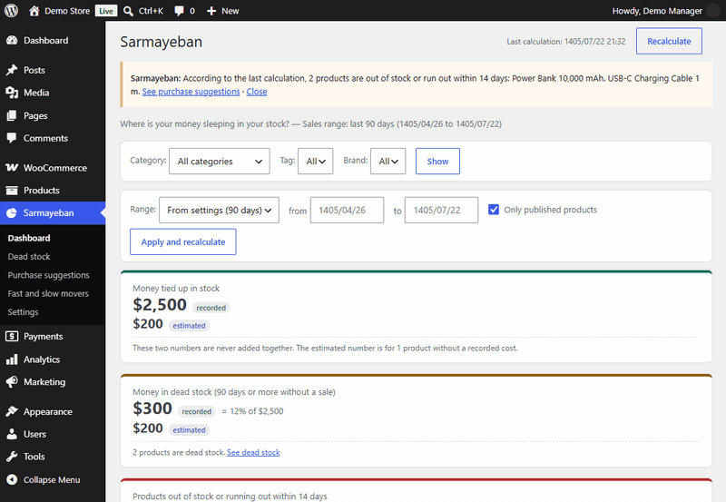
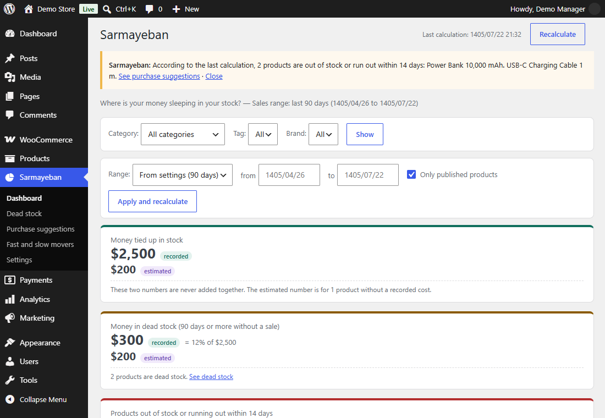
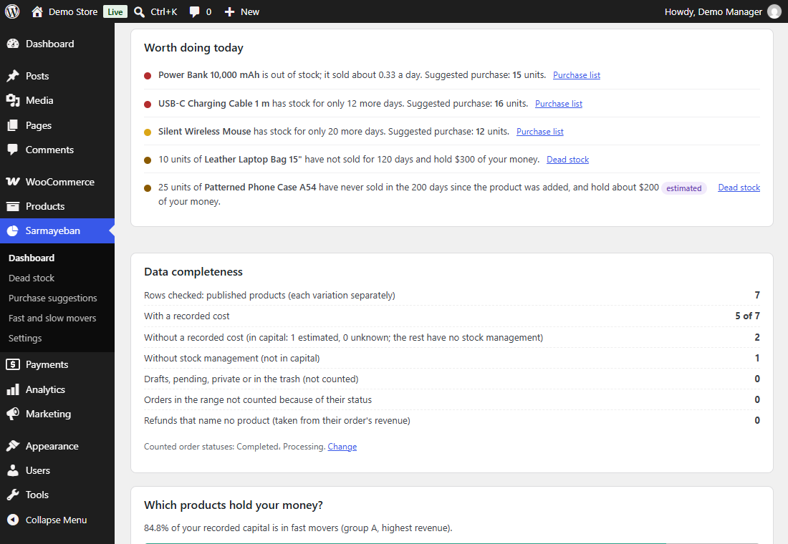
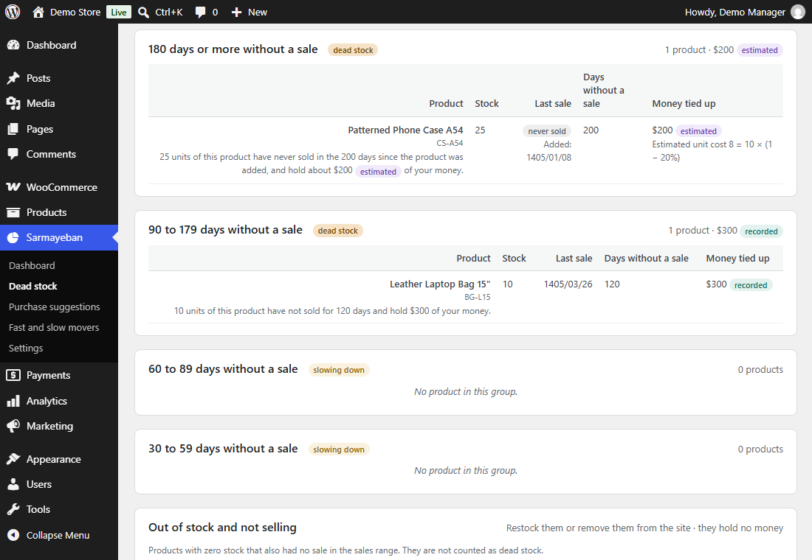
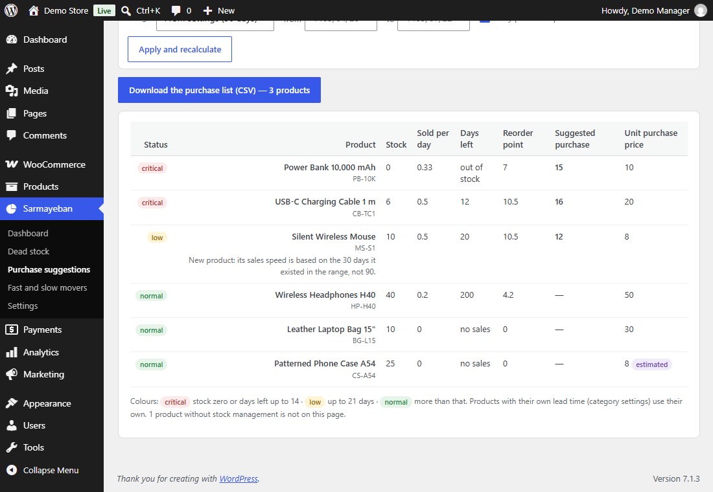
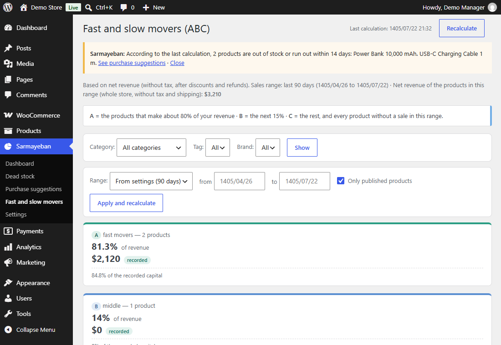
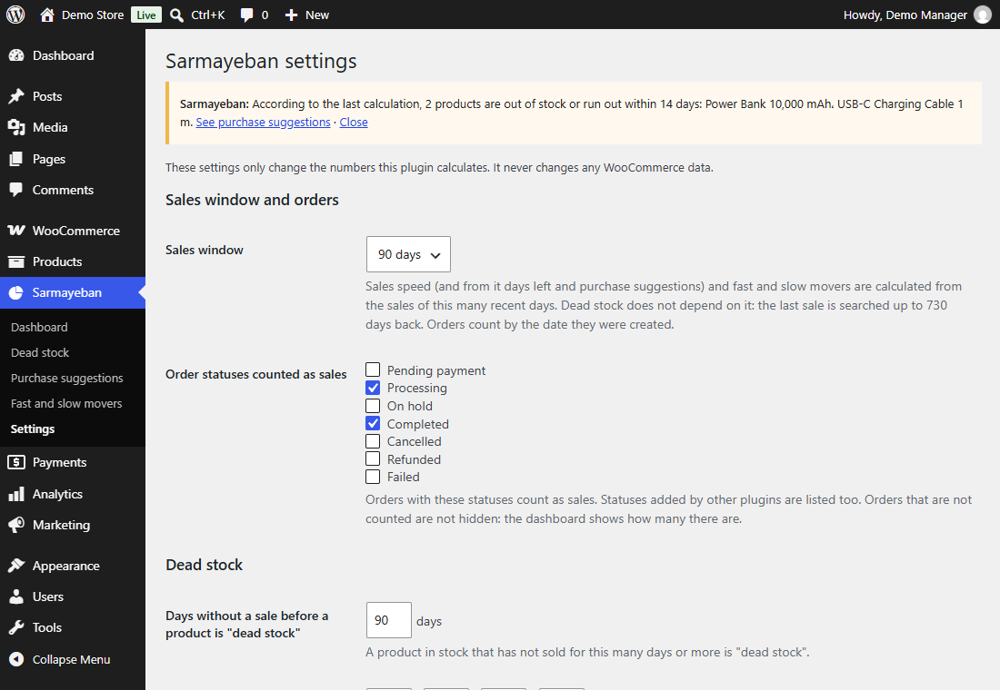

# Sarmayeban (سرمایه‌بان) — Inventory Capital Analytics for WooCommerce

**See how much money is sleeping in your stock, which products stopped selling, and what to buy before you run out — without the plugin ever changing a thing in your store.**

[فارسی](README.fa.md)



**Version 1.0.1** · **Author: [Shahin Parsa](https://www.linkedin.com/in/shahin-parsa/)** · Source code: private (commercial product). This repository is a showcase: description, screenshots and quality evidence.

---

## 1. The problem

A small online shop sells phone accessories. Its owner knows the sales figures, but not these:

- **$2,500** is tied up in stock right now — and **$300 of it (12%)** sits in products that have not sold for 90 days or more.
- A power bank is already **out of stock**, and a charging cable will run out in **12 days**, while the supplier needs **14 days** to deliver.
- One phone case has **never sold** in the 200 days since it was added, but nobody noticed because it has no recorded cost.

Finding this by hand means exporting orders, matching them to products, working out sales per day and stock cover, and repeating it every week. (Numbers from the fictional demo store shown in the screenshots.)

## 2. What it does

| Page | What the shop owner sees |
|---|---|
| **Dashboard** | Money tied up in stock (recorded cost and estimated cost shown apart, never added), share in dead stock, products running out, value at today's purchase prices, and a short list of what is worth doing today |
| **Dead stock** | Products grouped by days without a sale (30, 60, 90, 180+), the money in each group, products that were never sold, and products that are out of stock and not selling |
| **Purchase suggestions** | For every product: stock, sales per day, days left, reorder point and suggested quantity, with critical / low / normal status — and a CSV purchase list |
| **Fast and slow movers (ABC)** | Products ranked by net revenue into groups A (≈80% of revenue), B (next 15%) and C, with each group's share of the money in stock |
| **Settings** | Sales window, counted order statuses, dead-stock threshold, lead time, safety days and target cover (per category if needed), assumed margins |
| **Dashboard notice** | A notice on the WordPress dashboard when products are out of stock or about to run out |

Filters by category, tag and brand, and by sales range (including a custom range typed as Jalali dates), work on every result page.

<p>


</p>
<p>


</p>
<p>


</p>

## 3. Why it is different

| | Spreadsheet by hand | Typical inventory-management plugin | Sarmayeban |
|---|---|---|---|
| Main purpose | Anything, if you build it | Editing and syncing stock | Showing where money is stuck and what to buy |
| Money tied up in stock and in dead stock | Manual formulas | Usually stock quantities, not money | Yes, recorded and estimated kept apart |
| Days left and suggested purchase quantity | Manual | Varies | Yes, with lead time and safety days per category |
| Works when purchase costs were never entered | — | Usually needs costs | Yes: estimates from an assumed margin and labels it "estimated" |
| Works without stock tracking | — | Usually needs it | Yes: still lists products with no sales |
| Changes store data | Possible by mistake | Yes, by design | **Never** (read-only, proven by tests) |
| Sends store data anywhere | Depends | Some use cloud services | **Never** (fully offline, proven by tests) |
| Persian interface and Jalali calendar | — | Rarely | Built in, without double conversion when other Jalali plugins are active |

## 4. Engineering highlights

- **Large stores on cheap hosting.** A store with 20,000 products and 100,000 orders is calculated under a hard 128 MB memory limit. The work is split into requests of at most 10 seconds, rows are read in chunks, orders are read one day at a time, and long tables are paged.
- **Honest numbers.** Recorded costs and estimated costs are never added together. Every estimated amount carries a label, and a "data completeness" card tells the owner what the numbers are based on.
- **Correct handling of WooCommerce details.** Variations that share their parent's stock are counted once; refunds (including amount-only refunds) reduce revenue; unfinished block checkouts are not orders; both order storages (HPOS and legacy) give the same results.
- **Safe recalculation.** An atomic lock prevents two calculations at once; the last finished result stays visible until a new one is complete; if the host kills a request, the lock is released at once.
- **Its own calendar.** Jalali dates are converted inside the plugin, so date plugins that rewrite WordPress dates cannot convert them twice.
- **A WooCommerce 11.2 slowdown found and avoided.** Reading order lines through the usual method loaded every product with its categories, making large stores about 5× slower; the plugin reads them through the order data store instead.

## 5. Architecture & logic

```text
 WooCommerce (read-only, CRUD API)
   products ──► Product reader ──► rows (simple / variation / parent-level stock)
   orders   ──► Sales reader   ──► per row: net units, net revenue, last sale
                      │
                      ▼
          Calculation job (steps of ≤10 s, atomic lock, resumable)
                      │  velocity · days left · reorder point · suggestion
                      │  dead-stock groups · capital · ABC classes
                      ▼
          Plugin's own table + summary option  (nothing else is written)
                      │
                      ▼
  Page models (stream rows in chunks, keep only sort keys) ──► admin pages · CSV · notice
```

Design principles:

1. **Read-only by contract.** The plugin writes only its own options and its own table.
2. **No external requests.** No HTTP calls, CDN assets, remote fonts or telemetry.
3. **Never hold the whole store in memory.** Stream, keep sort keys, load only the page being shown.
4. **Never mix certain and uncertain numbers.** Recorded and estimated amounts stay apart, with labels.
5. **Known answers first.** Expected numbers were written down before the code, and tests compare against them.
6. **Verify, then write.** Every WooCommerce API was checked in WooCommerce's own source code before use.

## 6. Tech stack and skills

| Area | Technology |
|---|---|
| Platform | WordPress 6.7–7.1, WooCommerce 10.3–11.2 (HPOS and legacy order storage, Cost of Goods Sold) |
| Language | PHP 7.4–8.3 (7,732 lines in 41 files), vanilla JavaScript and CSS (264 lines) |
| Data | WooCommerce CRUD API, a custom table with prepared SQL only, an atomic options lock |
| Quality | PHPUnit (WordPress test suite), PHPCS with WordPress Coding Standards, PHPStan, WordPress.org Plugin Check |
| Test environment | Private WordPress + MySQL 8.4, WP-CLI, real HTTP tests with PHP's built-in server, headless Chrome screenshots |
| Localisation | Persian translation, Jalali calendar, right-to-left layout |

Skills shown: product definition and requirements, WooCommerce internals, performance and memory engineering, secure WordPress development (capabilities, nonces, escaping, CSV injection), test design with known answers, release engineering, and directing an AI coding agent with clear guardrails.

## 7. How quality was proven

- **165 automated tests per configuration**, in 4 configurations (oldest and newest supported PHP/WordPress/WooCommerce, each with HPOS on and off) — all passing, plus 5 tests with WooCommerce inactive.
- **Performance:** 10,000 products and 50,000 orders — slowest request 11.56 s (limit 20 s), calculation memory 16.1 MB, heaviest page 11.7 MB.
- **Shared hosting:** 20,000 products and 100,000 orders under 128 MB / 30 s / 4 MB packet — everything works, 0 PHP errors (version 1.0.0 could not even start; the fixes are in 1.0.1).
- **Security:** two automated reviews with 0 critical or high findings, 30 real-HTTP attack checks, and proofs that the plugin changes nothing and sends nothing. A human security review is still to come before the first sale.
- **Compatibility:** identical results next to the two most-installed Jalali-date plugins on WordPress.org (30 of 30 checks).

Details and sources: [docs/quality-evidence.en.md](docs/quality-evidence.en.md)

## 8. How it was built — and my role

I am the **product owner**. I defined the product, made every product decision and approved each step; the code was written by an AI coding agent (**Claude Code**) working under my direction. I do not write the code myself — my job was to decide what to build, set the rules, and check the results.

The guardrails I set:

- **A fixed process:** visual mockups first, then the requirements, test data and task list — no code before I approved each of them.
- **Written hard rules** the agent had to follow: read-only product, no external requests, local test environment only (never a real store), verify every WooCommerce API in its source before using it, stop after three failed attempts, one task at a time.
- **"Done" means proven:** a task counted as done only when its tests, the coding standards check, static analysis and Plugin Check passed, with the real output shown to me.
- **I checked by eye:** I compared screenshots against the hand-calculated answer tables.
- **I kept control of publishing:** every change came as a separate branch and pull request that I reviewed and merged myself (30 pull requests); the agent could not push.

The project went from first commit to version 1.0.1 between 2026-10-09 and 2026-10-14 (85 commits).

## 9. Demo & proof

- Screenshots: [assets/en](assets/en) (English interface, US dollars) and [assets/fa](assets/fa) (Persian interface, toman).
- All screenshots come from a **demo store with fictional products, orders and amounts**; no real shop or customer data was used. Dates are shown in the Jalali (Solar Hijri) calendar, as the product is built for Iranian shops.
- Quality evidence: [docs/quality-evidence.en.md](docs/quality-evidence.en.md)
- Persian user guide and FAQ: [docs/user-guide](docs/user-guide)

## 10. Author & contact

**Shahin Parsa** (شاهین پارسا)

- LinkedIn: [linkedin.com/in/shahin-parsa](https://www.linkedin.com/in/shahin-parsa/)
- Telegram: [@S3DEngineerP](https://t.me/S3DEngineerP)

## 11. License

The text, documents and images of this showcase are under the [MIT License](LICENSE). The Sarmayeban plugin's source code is private and is not included.
