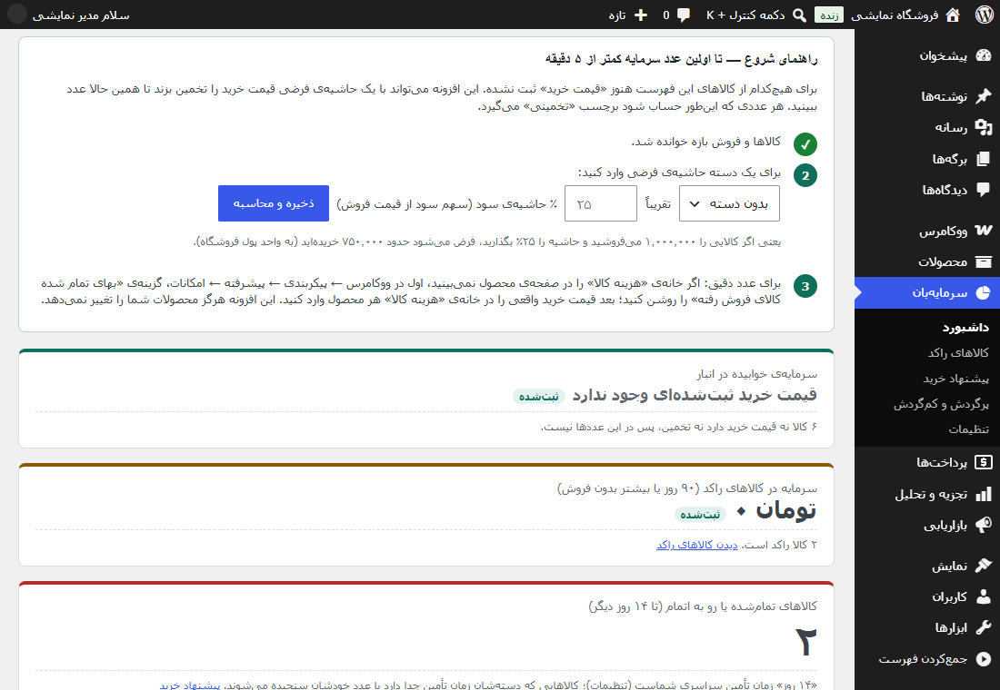
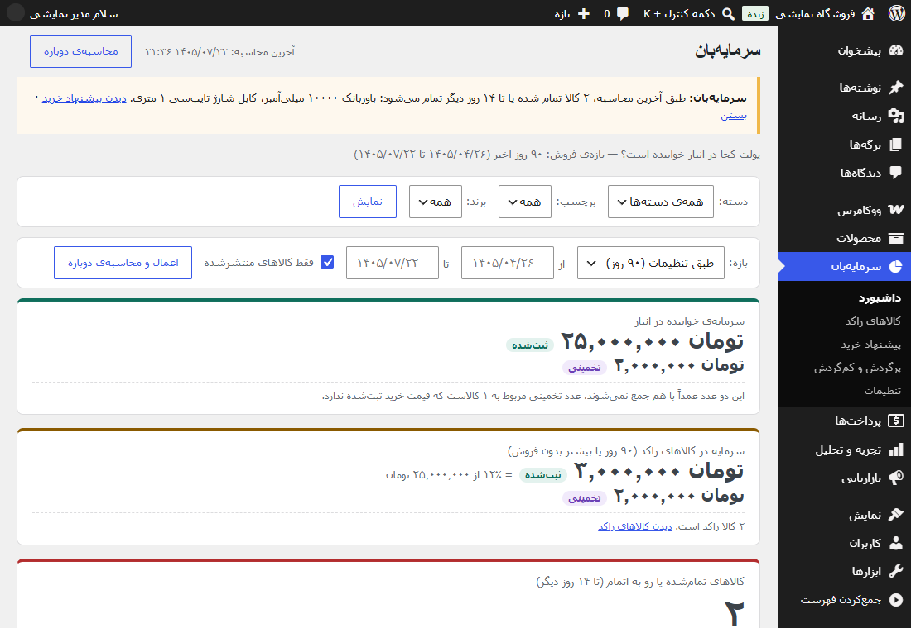
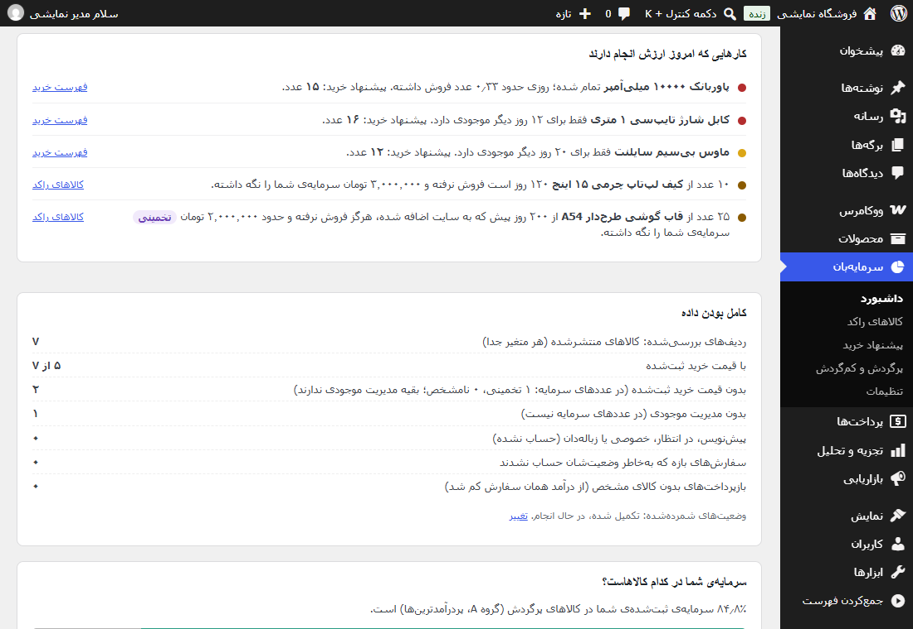
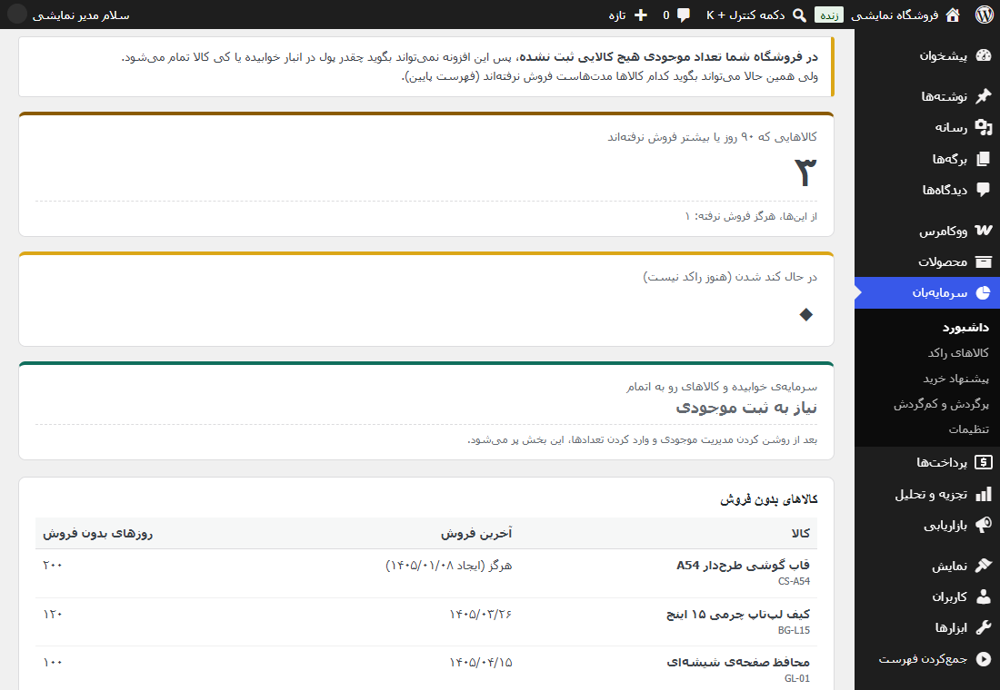
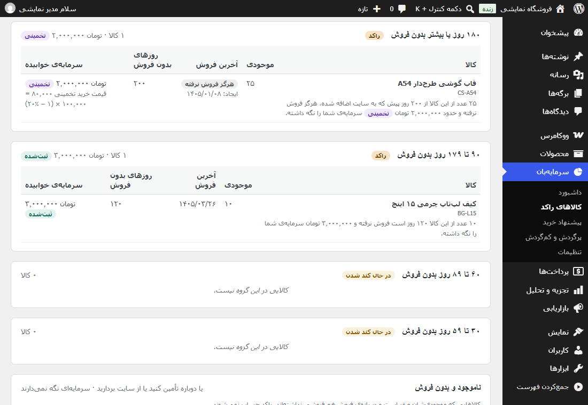
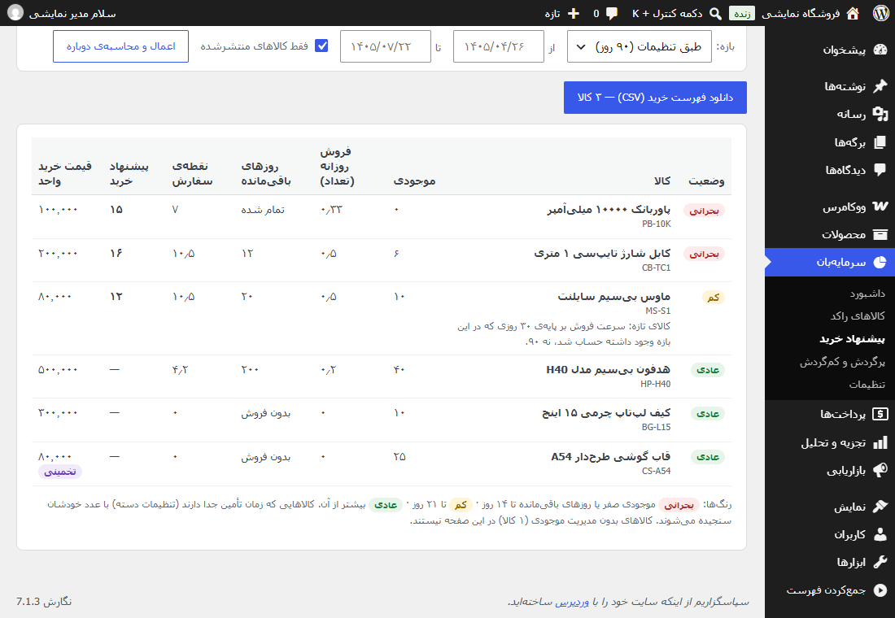
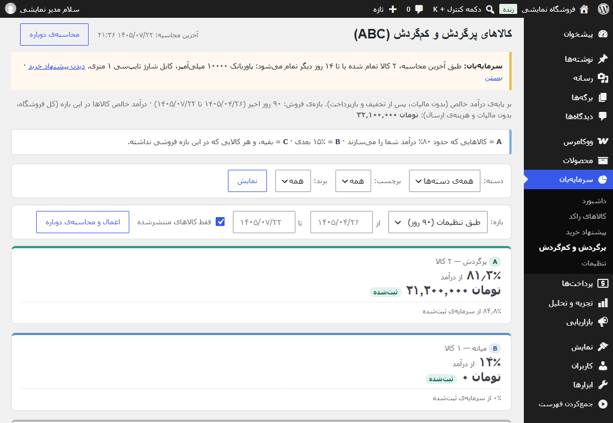
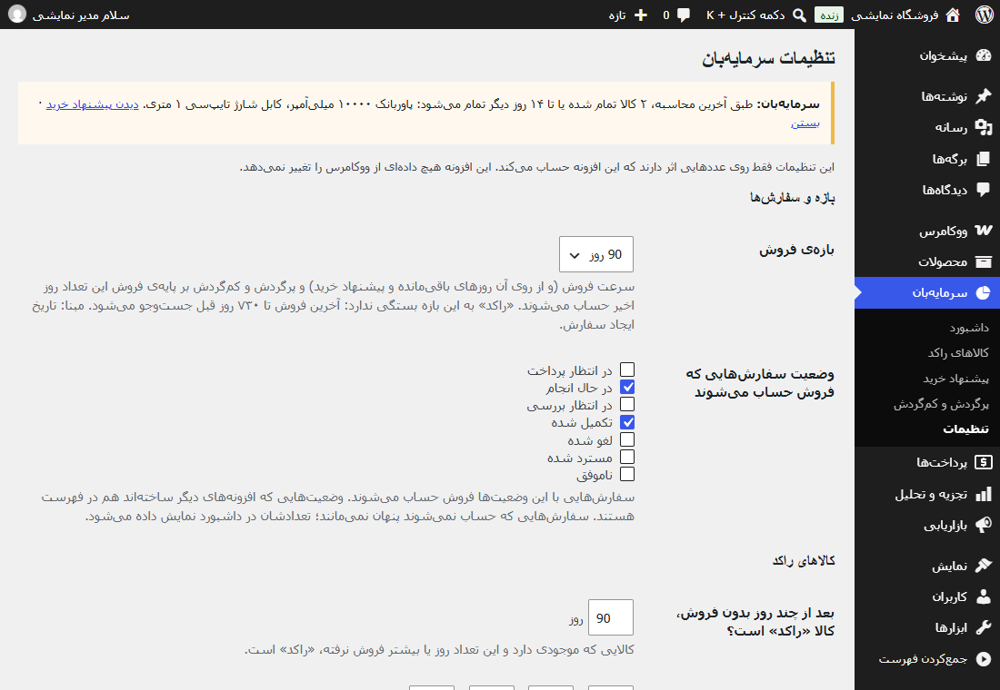

# راهنمای سرمایه‌بان

**سرمایه‌بان** به شما نشان می‌دهد:
- چقدر پول در انبار فروشگاه ووکامرسی‌تان خوابیده است؛
- کدام کالاها ماه‌هاست فروش نرفته‌اند؛
- موجودی هر کالا برای چند روز کافی است؛
- از هر کالا چقدر باید دوباره بخرید.

این افزونه فقط می‌خواند: هرگز قیمت، موجودی، سفارش یا محصولی را تغییر نمی‌دهد و فقط تنظیمات و نتیجه‌ی محاسبه‌ی خودش را ذخیره می‌کند. کاملاً آفلاین هم هست، یعنی به هیچ سرور یا سرویس بیرونی وصل نمی‌شود. سایت شما همچنان آنلاین است و سرمایه‌بان را در پیشخوان وردپرس باز می‌کنید؛ «آفلاین» یعنی خود افزونه به اینترنت بیرون نیازی ندارد.

---

## فهرست

1. [پیش‌نیازها](#پیش‌نیازها)
2. [نصب و اولین عدد](#نصب-و-اولین-عدد)
3. [داشبورد](#داشبورد)
4. [کالاهای راکد](#کالاهای-راکد)
5. [پیشنهاد خرید](#پیشنهاد-خرید)
6. [پرگردش و کم‌گردش (ABC)](#پرگردش-و-کمگردش-abc)
7. [فیلترها و بازه‌ی فروش](#فیلترها-و-بازه‌ی-فروش)
8. [تنظیمات](#تنظیمات)
9. [هشدار در پیشخوان وردپرس](#هشدار-در-پیشخوان-وردپرس)
10. [محاسبه‌ی دوباره](#محاسبه‌ی-دوباره)
11. [غیرفعال کردن و حذف](#غیرفعال-کردن-و-حذف)
12. [عددها چطور حساب می‌شوند](#عددها-چطور-حساب-می‌شوند)

پرسش‌های متداول در فایل جداگانه‌ی [پرسش‌های متداول](faq-fa.md) آمده است.

---

## پیش‌نیازها

| مورد | حداقل نسخه |
|---|---|
| وردپرس | ۶٫۷ |
| ووکامرس | ۱۰٫۳ |
| PHP | ۷٫۴ |

- با هر دو روش ذخیره‌ی سفارش ووکامرس کار می‌کند: جدول‌های تازه‌ی سفارش (HPOS) و روش قدیمی.
- فقط کاربرانی که اجازه‌ی مدیریت ووکامرس دارند، مثل **مدیر کل** و **مدیر فروشگاه**، صفحه‌های سرمایه‌بان را می‌بینند.
- آزمایش‌شده با وردپرس ۶٫۷ و ۷٫۱، ووکامرس ۱۰٫۳ و ۱۱٫۲، و PHP ۷٫۴ و ۸٫۳.
- محصولات گروهی (grouped) و خارجی یا وابسته (external) حساب نمی‌شوند، چون موجودی خودشان را ندارند.

**برای عدد دقیق‌تر، بهتر است این دو مورد در ووکامرس روشن باشد.** سرمایه‌بان بدون آن‌ها هم کار می‌کند و راهنمایی‌تان می‌کند.
- **مدیریت موجودی:** بدون تعداد موجودی، سرمایه‌ی خوابیده و روزهای باقی‌مانده قابل محاسبه نیست. ولی فهرست کالاهای بدون فروش همچنان نمایش داده می‌شود.
- **قیمت خرید:** اگر قیمت خرید ثبت نکرده باشید، سرمایه‌بان آن را با یک حاشیه‌ی سود فرضی تخمین می‌زند و عدد را «تخمینی» نشان می‌دهد.

### روشن کردن مدیریت موجودی در ووکامرس

1. **ووکامرس ← پیکربندی ← محصولات ← فهرست موجودی**. در انگلیسی: WooCommerce ← Settings ← Products ← Inventory. تیک «فعال کردن مدیریت موجودی انبار» (Enable stock management) را بزنید.
2. در صفحه‌ی ویرایش هر محصول، زبانه‌ی «فهرست موجودی» (Inventory): تیک «مدیریت موجودی» (Stock management) را بزنید و تعداد موجود را وارد کنید.

### ثبت قیمت خرید در ووکامرس

ووکامرس از نسخه‌ی ۱۰٫۳ یک فیلد رسمی برای قیمت خرید دارد، ولی این فیلد به‌طور پیش‌فرض خاموش است.
1. **ووکامرس ← پیکربندی ← پیشرفته ← امکانات**. در انگلیسی: WooCommerce ← Settings ← Advanced ← Features. گزینه‌ی «بهای تمام شده کالای فروش رفته» (Cost of Goods Sold) را روشن و ذخیره کنید.
2. در صفحه‌ی ویرایش هر محصول، فیلد «هزینه کالا» (Cost of goods) را پر کنید. برای کالای متغیر، این فیلد را برای هر متغیر هم می‌توانید جدا پر کنید.

> اگر افزونه‌ی فارسی‌ساز دیگری نصب دارید، نام منوها ممکن است کمی فرق کند. نام انگلیسی داخل پرانتز همیشه همان است.

---

## نصب و اولین عدد

1. فایل zip را از **افزونه‌ها ← افزودن ← بارگذاری افزونه** نصب و فعال کنید.
2. بعد از فعال‌سازی، به‌طور خودکار به **داشبورد سرمایه‌بان** می‌روید و اولین محاسبه همان‌جا شروع می‌شود. نوار پیشرفت مراحل را نشان می‌دهد: خواندن کالاها، خواندن فروش و محاسبه.
3. **تا پایان محاسبه صفحه را باز نگه دارید.** محاسبه در چند مرحله‌ی کوتاه انجام می‌شود تا هاست شما زیر فشار نرود، و صفحه‌ی باز این مراحل را جلو می‌برد. اگر صفحه را ببندید، دفعه‌ی بعد «محاسبه‌ی دوباره» را بزنید.
4. وقتی محاسبه تمام شد، عددها در همان صفحه نمایش داده می‌شوند.

**اگر برای هیچ کالایی قیمت خرید ثبت نشده باشد،** داشبورد یک **راهنمای شروع** نشان می‌دهد:
1. یک دسته‌ی محصول انتخاب کنید.
2. حاشیه‌ی سود تقریبی آن را وارد کنید. مثلاً ۲۵٪ یعنی کالایی که ۱٬۰۰۰٬۰۰۰ تومان می‌فروشید، حدود ۷۵۰٬۰۰۰ تومان خریده‌اید.
3. «ذخیره و محاسبه» را بزنید. چند لحظه بعد سرمایه‌ی **تخمینی** آن دسته نمایش داده می‌شود.

بعداً می‌توانید از صفحه‌ی **تنظیمات** برای دسته‌های دیگر هم حاشیه وارد کنید.

---

## داشبورد

منوی **سرمایه‌بان ← داشبورد**

### سه عدد بزرگ

1. **سرمایه‌ی خوابیده در انبار:** موجودی × قیمت خرید، برای کالاهایی که مدیریت موجودی و موجودی بیشتر از صفر دارند و قیمت خریدشان (ثبت‌شده یا تخمینی) معلوم است.
2. **سرمایه در کالاهای راکد:** همان عدد، فقط برای کالاهایی که مدتی فروش نرفته‌اند (پیش‌فرض ۹۰ روز یا بیشتر)، همراه با درصدش از کل.
3. **کالاهایی که تا ۱۴ روز دیگر تمام می‌شوند:** «۱۴ روز» همان زمان تأمین شماست، یعنی مدتی که طول می‌کشد کالای سفارش‌داده به انبار برسد. این عدد در تنظیمات قابل تغییر است.

**قاعده‌ی مهم: عددهای «ثبت‌شده» و «تخمینی» هرگز با هم جمع نمی‌شوند.**
- عددی که از قیمت خریدِ واقعاً ثبت‌شده آمده، برچسب **ثبت‌شده** دارد.
- عددی که از حاشیه‌ی فرضی آمده، جدا و با برچسب **تخمینی** نوشته می‌شود.

این‌طور همیشه می‌دانید کدام عدد قطعی است و کدام تقریبی.

### کارهایی که امروز ارزش انجام دارند

زیر عددها، فهرست کوتاهی از مهم‌ترین کارها با یک جمله‌ی ساده آمده است. مثال:
> «۱۰ عدد از P3 ۱۲۰ روز است فروش نرفته و ۳٬۰۰۰٬۰۰۰ تومان سرمایه‌ی شما را نگه داشته.»
> «P2 فقط برای ۱۲ روز دیگر موجودی دارد. پیشنهاد خرید: ۱۶ عدد.»

دکمه‌ی **فهرست خرید** شما را مستقیم به صفحه‌ی پیشنهاد خرید می‌برد.

### کامل بودن داده

این جدول نشان می‌دهد عددها روی چه داده‌ای ساخته شده‌اند:
- چند کالا بررسی شد؛
- چند تا قیمت خرید ثبت‌شده دارند؛
- چند تا مدیریت موجودی ندارند؛
- چند کالای پیش‌نویس، در انتظار بررسی، خصوصی یا زباله‌دان حساب نشده؛
- چند سفارش به‌خاطر وضعیتشان حساب نشده‌اند.

سرمایه‌بان هیچ چیزی را بی‌صدا کنار نمی‌گذارد.

### بخش‌های دیگر داشبورد

- **سرمایه‌ی شما در کدام کالاهاست؟** خلاصه‌ای از صفحه‌ی ABC.
- **ارزش انبار به قیمت خرید امروز:** فقط اگر در تنظیمات بگویید قیمت خرید از زمان خرید کالاها چند درصد بالا رفته است. این درصد فقط به سرمایه‌ی ثبت‌شده اضافه می‌شود. بخش تخمینی همان عدد تخمینی می‌ماند، چون قیمت تخمینی خودش از قیمت فروش امروز ساخته شده است. این عدد همیشه «برآوردی» است.

### اگر مدیریت موجودی ندارید

داشبورد به‌جای صفر:
- توضیح می‌دهد چرا سرمایه قابل محاسبه نیست؛
- قدم‌های روشن کردن مدیریت موجودی را نشان می‌دهد؛
- همین حالا فهرست کالاهایی را که مدت‌هاست فروش نرفته‌اند نشان می‌دهد.

---

## کالاهای راکد

منوی **سرمایه‌بان ← کالاهای راکد**

کالایی **راکد** است که هم **موجودی دارد** و هم مدتی فروش نرفته است. این مدت به‌طور پیش‌فرض ۹۰ روز یا بیشتر است و در تنظیمات قابل تغییر است.
- **گروه‌ها:** کالاها بر اساس روزهای بدون فروش گروه‌بندی می‌شوند: ۳۰ تا ۵۹، ۶۰ تا ۸۹، ۹۰ تا ۱۷۹، و ۱۸۰ روز به بالا. گروه‌های زیر آستانه‌ی راکد «در حال کند شدن» نام دارند. این کالاها هنوز راکد نیستند، ولی بهتر است زیر نظر باشند.
- **برای هر کالا:** موجودی، تاریخ آخرین فروش به شمسی، و سرمایه‌ی خوابیده نمایش داده می‌شود. کالایی که هرگز فروش نرفته برچسب «هرگز فروش نرفته» دارد.
- **مرتب‌سازی:**
  - بیشترین سرمایه‌ی خوابیده (پیش‌فرض)؛
  - بیشترین روز بدون فروش؛
  - بیشترین موجودی.
- **ناموجود و بدون فروش:** کالاهایی که موجودی‌شان صفر است و در بازه هم فروشی نداشته‌اند. سرمایه‌ای نگه نمی‌دارند و راکد حساب نمی‌شوند. یا دوباره تأمینشان کنید، یا اگر دیگر نمی‌فروشید، خودتان از سایت برشان دارید؛ سرمایه‌بان چیزی را حذف نمی‌کند.
- **کالاهای بدون مدیریت موجودی که فروش نرفته‌اند:** جدا آمده‌اند و در عددهای سرمایه حساب نمی‌شوند.

آخرین فروش، حتی بیرون از بازه‌ی فروش، تا ۷۳۰ روز عقب جست‌وجو می‌شود. اگر در این مدت فروشی نبوده، «بیش از ۷۳۰» نوشته می‌شود.

---

## پیشنهاد خرید

منوی **سرمایه‌بان ← پیشنهاد خرید**

### هر ستون جدول چه می‌گوید

- **فروش روزانه:** میانگین فروش خالص روزانه در بازه‌ی فروش، یعنی فروش منهای بازپرداخت.
- **روزهای باقی‌مانده:** موجودی ÷ فروش روزانه. اگر کالایی فروش نداشته، «بدون فروش» نوشته می‌شود.
- **نقطه‌ی سفارش:** فروش روزانه × (زمان تأمین + روزهای اطمینان). اگر موجودی به این عدد یا کمتر برسد، وقت خرید است.
- **پیشنهاد خرید:** آن‌قدر که پس از رسیدن کالا، موجودی برای «روزهای پوشش هدف» کافی باشد. این مقدار همیشه به بالا گرد می‌شود.

### رنگ‌ها

- 🔴 **بحرانی:** موجودی صفر است، یا تا پایان زمان تأمین تمام می‌شود.
- 🟠 **کم:** تا پایان «زمان تأمین + روزهای اطمینان» تمام می‌شود.
- **عادی:** بیشتر از آن موجودی دارد.

با گزینه‌های بالای جدول، فقط کالاهای بحرانی، کم، یا هر کالایی که نیاز به خرید دارد را ببینید.

### فهرست خرید (CSV)

دکمه‌ی **دانلود فهرست خرید (CSV)** فایلی با این ستون‌ها می‌دهد:
- کد کالا (SKU)؛
- نام؛
- موجودی؛
- مقدار پیشنهادی؛
- قیمت خرید واحد، یعنی قیمت خرید فعلی ثبت‌شده در محصول یا قیمت تخمینی، نه قیمت آخرین فاکتور؛
- برچسب قیمت: ثبت‌شده، تخمینی یا نامشخص.

فایل با UTF-8 و BOM ساخته می‌شود تا Excel و Google Sheets حروف فارسی را درست بخوانند.

**سرمایه‌بان هیچ سفارش خریدی ثبت نمی‌کند.** این فایل فقط فهرست پیشنهادی است و تصمیم با شماست.

### نکته‌ها

- **کالای تازه:** کالایی که کمتر از طول بازه در سایت بوده، با روزهایی که واقعاً وجود داشته سنجیده می‌شود. مثلاً کالایی که ۳۰ روز پیش اضافه شده و ۱۵ عدد فروخته، روزی ۰٫۵ فروش دارد، نه ۰٫۱۷. کنار این کالاها توضیح کوتاهی نوشته می‌شود.
- **موجودی منفی (پیش‌فروش):** در محاسبه صفر حساب می‌شود و کالا بحرانی است. عدد منفی واقعی کنارش نمایش داده می‌شود.
- اگر برای یک دسته زمان تأمین جدا تعیین کرده باشید، کالاهای آن دسته با عدد خودشان سنجیده می‌شوند.

---

## پرگردش و کم‌گردش (ABC)

منوی **سرمایه‌بان ← پرگردش و کم‌گردش**

کالاها بر اساس **درآمد خالص** در بازه‌ی فروش مرتب می‌شوند. درآمد خالص یعنی بدون مالیات، پس از تخفیف و پس از بازپرداخت.
- **A (پرگردش):** کالاهایی که حدود ۸۰٪ درآمد شما را می‌سازند.
- **B (میانه):** ۱۵٪ بعدی.
- **C (کم‌گردش):** بقیه، و هر کالایی که در بازه فروشی نداشته است.

مهم‌ترین عدد این صفحه **سهم هر گروه از سرمایه‌ی خوابیده** است. اگر بخش بزرگی از پولتان در گروه C باشد، یعنی پول زیادی در کالاهایی خوابیده که درآمد کمی می‌سازند.

با فیلتر دسته یا برچسب هم، گروه و رتبه‌ی هر کالا همان عدد کل فروشگاه است. فیلتر فقط فهرست را کوتاه‌تر می‌کند.

---

## فیلترها و بازه‌ی فروش

بالای هر صفحه دو نوار فیلتر وجود دارد:

1. **دسته، برچسب و برند،** با دکمه‌ی «نمایش»: فقط نمایش را محدود می‌کنند و محاسبه‌ی تازه لازم ندارند. برند همان برند استاندارد ووکامرس است.
2. **بازه و «فقط کالاهای منتشرشده»،** با دکمه‌ی «اعمال و محاسبه‌ی دوباره»: عددها را عوض می‌کنند، پس محاسبه‌ی تازه شروع می‌شود.
   - **بازه:** طبق تنظیمات، یا ۳۰، ۶۰، ۹۰ یا ۱۸۰ روز اخیر، یا **بازه‌ی دلخواه شمسی**. در بازه‌ی دلخواه، تاریخ‌ها را مثل ۱۴۰۵/۰۴/۲۰ بنویسید. هر دو تاریخ باید در ۷۳۰ روز گذشته باشند.
   - **فقط کالاهای منتشرشده:** به‌طور پیش‌فرض روشن است. اگر خاموشش کنید، پیش‌نویس‌ها، کالاهای در انتظار و خصوصی هم حساب می‌شوند.

---

## تنظیمات

منوی **سرمایه‌بان ← تنظیمات**. این صفحه از لینک «تنظیمات» کنار نام افزونه در صفحه‌ی افزونه‌ها هم باز می‌شود.

| تنظیم | پیش‌فرض | توضیح |
|---|---|---|
| بازه‌ی فروش | ۹۰ روز | ۳۰، ۶۰، ۹۰ یا ۱۸۰ روز. مبنا تاریخ ایجاد سفارش است. |
| وضعیت سفارش‌هایی که فروش حساب می‌شوند | «تکمیل شده» و «در حال انجام» | وضعیت‌هایی که افزونه‌های دیگر ساخته‌اند هم در فهرست هستند، مثلاً «ارسال‌شده». |
| بعد از چند روز بدون فروش، کالا «راکد» است؟ | ۹۰ | ۱ تا ۷۳۰. |
| گروه‌بندی روزهای بدون فروش | ۳۰، ۶۰، ۹۰، ۱۸۰ | چهار عدد صعودی. |
| زمان تأمین | ۱۴ روز | از وقتی سفارش خرید می‌دهید تا کالا به انبار برسد. |
| روزهای اطمینان | ۷ روز | حاشیه‌ی احتیاط برای دیر رسیدن کالا یا فروش بیشتر از معمول. |
| روزهای پوشش هدف | ۳۰ روز | پس از رسیدن کالا، موجودی برای چند روز فروش کافی باشد. |
| حاشیه‌ی فرضی سراسری | خالی | برای کالاهای بدون قیمت خرید: قیمت خرید تخمینی = قیمت فروش × (۱ − حاشیه). |
| درصد افزایش قیمت خرید | خالی | برای «ارزش انبار به قیمت خرید امروز»، فقط روی سرمایه‌ی ثبت‌شده. اگر خالی بماند، آن عدد نمایش داده نمی‌شود. |
| هشدار در پیشخوان وردپرس | روشن | بدون ایمیل و پیامک. |
| هنگام حذف افزونه: «تنظیمات و محاسبه‌های ذخیره‌شده‌ی این افزونه هم پاک شود» | خیر | فقط داده‌های خود سرمایه‌بان. داده‌های ووکامرس در هیچ حالتی پاک نمی‌شوند. |

**تنظیمات هر دسته:**
- برای هر دسته‌ی محصول می‌توانید حاشیه‌ی فرضی، زمان تأمین، روزهای اطمینان و روزهای پوشش هدف جدا تعیین کنید. خانه‌ی خالی یعنی همان مقدار سراسری.
- اگر کالایی در چند دسته باشد، مقدار اولین دسته‌ای که مقدار دارد به کار می‌رود، به ترتیب الفبای نام دسته.

بعد از تغییر تنظیمات، روی صفحه‌ها پیام «ممکن است به‌روز نباشد» ظاهر می‌شود. «محاسبه‌ی دوباره» را بزنید.

---

## هشدار در پیشخوان وردپرس

اگر در **آخرین محاسبه** کالایی بحرانی بوده، یعنی تا پایان زمان تأمین تمام می‌شود، یک اعلان کوچک در **صفحه‌ی اصلی پیشخوان وردپرس** و صفحه‌های سرمایه‌بان نمایش داده می‌شود. این اعلان با فروش‌های تازه خودکار عوض نمی‌شود؛ پس از «محاسبه‌ی دوباره» به‌روز می‌شود.
- تا سه نام کالا در آن آمده و بقیه با «و … کالای دیگر» شمرده می‌شوند.
- لینک «دیدن پیشنهاد خرید» مستقیم فهرست کالاهای بحرانی را باز می‌کند.
- با دکمه‌ی **بستن،** هشدار برای همه‌ی مدیران پنهان می‌شود و فقط وقتی دوباره ظاهر می‌شود که فهرست کالاهای بحرانی تغییر کند.
- برای خاموش کردن کامل، تیک «هشدار در پیشخوان وردپرس» را در تنظیمات بردارید.

سرمایه‌بان هیچ ایمیل یا پیامکی نمی‌فرستد.

---

## محاسبه‌ی دوباره

سرمایه‌بان عددها را یک بار حساب و ذخیره می‌کند. صفحه‌ها همان نتیجه را نشان می‌دهند، و بالای هر صفحه زمان **آخرین محاسبه** نوشته شده است.

دکمه‌ی **محاسبه‌ی دوباره** را وقتی بزنید که:
- فروش یا موجودی تازه‌ای دارید و عدد به‌روز می‌خواهید؛
- تنظیمات یا بازه را عوض کرده‌اید. پیام «ممکن است به‌روز نباشد» هم یادآوری‌تان می‌کند.

چند نکته:
- **مدت محاسبه:** محاسبه در مرحله‌های حدوداً ۱۰ ثانیه‌ای انجام می‌شود. در آزمون ما روی رایانه‌ی آزمون، نه یک هاست واقعی، فروشگاهی ساختگی با ۱۰٬۰۰۰ کالا و ۵۰٬۰۰۰ سفارش حدود ۵ دقیقه طول کشید. روی هاست شما ممکن است کمتر یا بیشتر باشد. **تا پایان، صفحه را باز نگه دارید.**
- **دو مدیر هم‌زمان:** اگر مدیر دیگری هم‌زمان محاسبه را شروع کند، هر دو صفحه به همان یک محاسبه وصل می‌شوند و محاسبه دو بار انجام نمی‌شود.
- **در صورت خطا:** آخرین عددهای سالم نمایش داده می‌شوند و پیام راهنما می‌آید.

---

## غیرفعال کردن و حذف

- **غیرفعال کردن:** سایت دقیقاً مثل قبل کار می‌کند. تنظیمات و آخرین محاسبه برای فعال‌سازی بعدی می‌ماند.
- **حذف:** به‌طور پیش‌فرض تنظیمات و محاسبه‌های سرمایه‌بان نگه داشته می‌شوند، تا اگر دوباره نصبش کردید، از صفر شروع نکنید. اگر می‌خواهید همه‌چیز پاک شود، پیش از حذف در تنظیمات تیک «تنظیمات و محاسبه‌های ذخیره‌شده‌ی این افزونه هم پاک شود» را بزنید.
- **داده‌های ووکامرس** (محصولات، سفارش‌ها، موجودی، قیمت‌ها) در هیچ حالتی تغییر نمی‌کنند و پاک نمی‌شوند.

---

## عددها چطور حساب می‌شوند

این بخش برای کسی است که می‌خواهد عددها را خودش بررسی کند.

### داده‌ها

- **ردیف:** هر محصول ساده، یا هر متغیر (variation) به‌طور جدا. اگر موجودی کالای متغیر در سطح محصول مادر مدیریت می‌شود، همه‌ی متغیرهای آن یک ردیف می‌شوند و فروششان با هم جمع می‌شود.
- **فروش خالص:** تعداد فروخته‌شده منهای تعداد بازپرداخت‌شده، فقط در سفارش‌هایی با وضعیت‌های شمرده‌شده.
- **درآمد خالص:** مبلغ هر قلم سفارش بدون مالیات، پس از تخفیف و منهای مبلغ بازپرداخت‌شده.
- **قیمت خرید:** از فیلد «هزینه کالا»ی خود ووکامرس. اگر خالی یا صفر باشد: قیمت فروش فعال بدون مالیات × (۱ − حاشیه‌ی فرضی دسته یا سراسری). قیمت فروش فعال یعنی قیمت حراج اگر حراج همین حالا فعال است، وگرنه قیمت عادی. اگر حاشیه هم تعیین نشده باشد، قیمت خرید «نامشخص» است و آن کالا در عدد سرمایه نمی‌آید.

### فرمول‌ها

- **سرمایه‌ی خوابیده:** موجودی × قیمت خرید.
- **فروش روزانه:** فروش خالص در بازه ÷ روزهای مؤثر. روزهای مؤثر یعنی طول بازه، یا اگر کالا تازه است، روزهایی که در بازه وجود داشته.
- **روزهای بدون فروش:** روزهای گذشته از آخرین فروش، تا ۷۳۰ روز عقب. اگر کالا هرگز فروش نرفته، روزهای گذشته از ایجاد کالا.

### نمایش

- تاریخ‌ها شمسی‌اند.
- مبلغ‌ها به همان واحد پول فروشگاه شما نمایش داده می‌شوند، بدون تبدیل.
- محاسبه‌ها گرد نمی‌شوند. فقط عددی که نمایش داده می‌شود گرد می‌شود: مبلغ به عدد کامل واحد پول فروشگاه، و پیشنهاد خرید به بالا.

---

> تصویرهای این راهنما از یک فروشگاه نمایشی با داده‌های خیالی گرفته شده‌اند.
